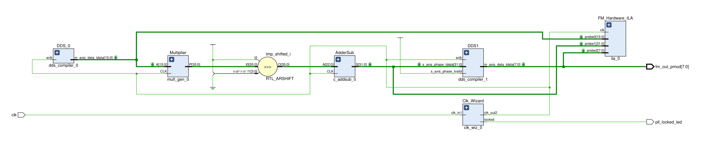
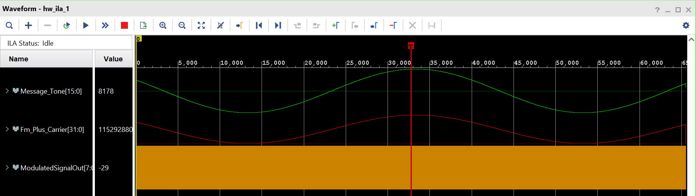
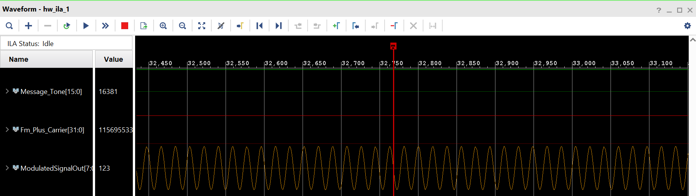
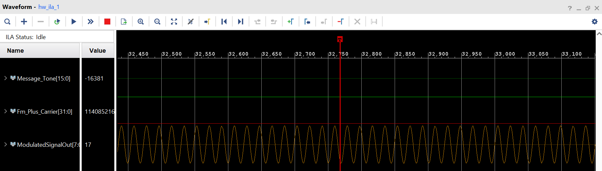
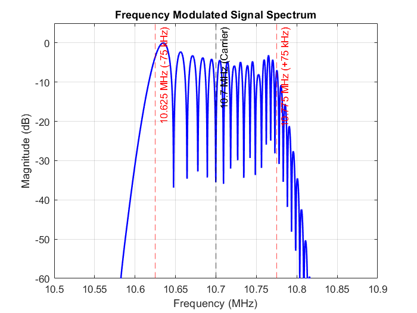

# Digital FM Modulator on FPGA

[-blue.svg)](https://digilent.com/reference/programmable-logic/nexys-a7/start)
[](https://www.xilinx.com/products/design-tools/vivado.html)
[]()
[]()

A synchronous and all-digital **Frequency Modulation (FM) Synthesizer** implemented in Verilog on *Digilent Nexys A7-100T* FPGA (`xc7a100tcsg324-1`) using AMD/Xilinx IP cores. 

This repository provides a complete mathematical derivation from continuous-time analog FM theory to discrete-time fixed-point hardware arithmetic, and a step-by-step implementation guide for this project.

>[!WARNING] **Disclaimer:** Over-the-air RF transmission in regulated bands without a license is prohibited in most jurisdictions. This hardware design is intended strictly for educational and on-chip logic analysis purposes.

---

## 1. Frequency Modulation: From Continuous to Discrete

### 1.1 Continuous-Time Analog FM Formulation
For a baseband message signal $m(t)$ to be transmitted through a carrier signal $c(t)$ by Frequency Modulation, the instantaneous frequency $f_i(t)$ of an FM signal should vary linearly with the normalized baseband message signal $m(t) \in [-1, 1]$ around the carrier frequency $f_c$:

$$f_i(t) = f_c + \Delta f \cdot m(t)$$

Since instantaneous angular frequency is the time-derivative of instantaneous phase ($\omega_i(t) = 2\pi f_i(t) = \frac{d\theta(t)}{dt}$), integrating with respect to time yields the instantaneous phase $\theta(t)$ and the standard analog FM signal $s(t)$:

$$\theta(t) = 2\pi f_c t + 2\pi \Delta f \int_{0}^{t} m(\tau)\,d\tau$$

$$s(t) = A_c \cos\left( 2\pi f_c t + 2\pi \Delta f \int_{0}^{t} m(\tau)\,d\tau \right)$$

---

### 1.2 Discretization of FM signal's phase & Mapping to an $N$-Bit Hardware Phase Accumulator
To discrete the analog FM signal $s(t)$, we use a sampling frequency $F_s$. Hence the continuous time $t$ is replaced by $n T_s = \frac{n}{F_s}$ and converts the continuous integral into discrete Riemann sum:

$$\theta[n] = 2\pi \frac{f_c}{F_s} n + 2\pi \frac{\Delta f}{F_s} \sum_{k=0}^{n} m[k]$$ $$\therefore \theta[n] = 2\pi \frac{f_c}{F_s} (n-1) + 2\pi \frac{\Delta f}{F_s} \sum_{k=0}^{n-1} m[k] + 2\pi \frac{f_c}{F_s} + 2\pi \frac{\Delta f}{F_s} m[n]$$ $$\therefore \theta[n] = \theta[n-1] + 2\pi\left( \frac{f_c}{F_s} + \frac{\Delta f}{F_s} m[n] \right)$$

Before going into further math, we should first fix certain parameters and decide on the system specifications:

| Parameter | Symbol | Value |
| :--- | :---: | :---: |
| **Message Frequency** | $f_m$ | $5\text{ kHz}$ |
| **Spurious-Free Dynamic Range** *- for m[n]* | $\text{SFDR}_m$ | $90\text{ dB}$ |
| **Carrier Frequency** | $f_c$ | $10.7\text{ MHz}$ |
| **Sampling Frequency** | $F_s$ | $200\text{ MHz}$ |
| **Frequency Resolution** | $\Delta f_{\text{res}}$ | $0.1\text{ Hz}$ |
| **Peak Frequency Deviation** | $\Delta f$ | $\pm 75\text{ kHz}$ |
| **Spurious-Free Dynamic Range** *- for s[n]* | $\text{SFDR}_s$ | $48\text{ dB}$ |

These parameters are arbitrarily chosen and can be varied as per the designer's choice or system requirements, except for $F_s$ as it is selected carefully such that we have enough no. of samples per cycle for carrier signal to be represented optimally.

To synthesize discrete signals of different frequencies, we just need to know how many cycles can a signal can cover in one second *OR* how much more cycles does the signal take with respect to the sampling frequency $-$ the lesser the frequency the more cycles it will take. So we can just implement the phase of a signal using an accumulator. Imagine we divide the complete $2\pi$ phase cycle into a number of points and we use the phase accumulator as a pointer with modulo (%) to jump over those points. *The slowest signal will take more time and jump over just one point in one clock cycle of sampling frequency, but the fastest signal i.e., the sampling frequency itself can jump over all of those points in one clock cycle.* So the no. of points will be directly proportional to the frequency. In our case, the slowest frequency is $\Delta f_{res}$, and its number of points would be 1 per cycle. Let the total number of points be $L$, then $L$ can be expressed as $-$
$$\frac{L}{1} = \frac{F_{s}}{\Delta f_{res}} = \frac{200 \times 10^6}{0.1} = 2 \times 10^9$$
To store this much no. of points, we would require $N$ no. of bits which can be expressed as $-$
$$N = \log_{2}(L) = \log_{2}(2 \times 10^9) = 30.9 \approx 31 \hspace{0.1cm} \text{bits}$$

In an $N$-bit Phase Accumulator ($N = 31$), the $2\pi\text{ radian}$ ($360^\circ$) phase circle is mapped across $2^{31}$ binary states. Therefore, advancing one point means moving forward on phase circle by $\frac{2\pi}{2^{31}}$ radians. Hence, to move forward by $\theta[n]$ radians, we need to advance the circle by an integral multiple of $\frac{2\pi}{2^{31}}$ radians i.e., $$\theta[n] = \frac{2\pi}{2^{31}} \cdot \Phi[n]$$ where $\Phi[n] \in \{0,1,2,..., 2^{31}-1\}$

As we can't realize phase in terms of radians in digital arithmetic, we realize it in terms of $\Phi[n]$ which is an integer. It can be expressed as below:
$$\Phi[n] = \frac{2^{31}}{2\pi} \cdot \theta[n]$$
Substituting the $\theta[n]$ equation, we get $-$
$$\Phi[n] = \left( \Phi[n-1] + \frac{2^{31} \cdot f_c}{F_s} + \left(\frac{2^{31} \cdot \Delta f}{F_s}\right) \cdot m[n] \right) \bmod 2^{31}$$

---

### 1.3 Final Discrete FM Signal with Fixed-Point Normalization
To achieve a Spurious Free Dynamic Range $(\text{SFDR}_m)$ of **$90\text{ dB}$**, the no. of bits to represent the message signal value, by formula, must be $\lceil 90 / 6.02 \rceil = \textbf{15\text{ signed bits}}$ (1 sign bit + 14 magnitude bits). 

Similarly, to achieve the $\text{SFDR}_s$ of $48 \hspace{0.1cm} \text{dB}$, the no. of bits to represent the FM signal must be $\lceil 48 / 6.02 \rceil = \textbf{8\text{ signed bits}}$ (1 sign bit + 7 magnitude bits).

Instead of outputting a floating-point wave between $-1.0$ and $+1.0$, we output a `Message_Tone` ($M_{\text{tone}}[n]$) that swings between $-16,384$ and $+16,383$ ($\pm 2^{14}$), and divide it by $2^{14}$ by using arithmetic right-shift by 14 bits $($`>>> 14`$)$. 

Now let's derive the exact numerical expression of $s[n]$. Assume the term $\frac{2^{31} \cdot \Delta f}{F_s}$ as $\Delta P_{dev}$, the term $\frac{2^{31} \cdot f_c}{F_s}$ as $\Delta P_c$, and the step-size of phase accumulator for $m[n]$ as $\Delta P_m$.

1. $\Delta P_m = 5 \hspace{0.1cm}\text{kHz} \cdot \frac{2^{31}}{200 \hspace{0.1cm}\text{MHz}} \approx 53687$

2. $\Delta P_{dev} = \frac{2^{31} \cdot \hspace{0.1cm} 75 \hspace{0.05cm}\text{kHz}}{200 \hspace{0.1cm}\text{MHz}} \approx 805306$

3. $\Delta P_c = \frac{2^{31} \cdot \hspace{0.1cm} 10.7 \hspace{0.05cm}\text{MHz}}{200 \hspace{0.1cm}\text{MHz}} \approx 114890375$

The Phase Accumulator expresssion thus becomes $-$
$$\Phi[n] = \left( \Phi[n-1] + 114,890,375 + \left\lfloor\frac{805,306 \cdot M_{\text{tone}}[n]}{2^{14}} \right\rfloor \right) \bmod 2^{31}$$

The closed-form digital FM output $s[n]$ to be synthesized in hardware is therefore:

$$s[n] = \text{round}\left( 127 \cdot \cos\left( \frac{2\pi}{2^{31}} \left[ \sum_{k=0}^{n} \left( 114,890,375 + \left\lfloor \frac{805,306 \cdot M_{\text{tone}}[k]}{2^{14}} \right\rfloor \right) \bmod 2^{31} \right] \right) \right)$$

---

## 2. Hardware Implementation with Six-Stage Synchronous Pipeline

To implement the above complicated equation of $s[n]$ in hardware, we break it down into six different steps:

1. Generate the sampling frequency $F_s$ using the **Mixed-Mode Clock Manager (MMCM)** hardware block present on FPGA.

2. Synthesize the $M_{tone}[n]$ signal using the 31-bit Phase Accumulator and Sin/Cos Lookup Table present in the **DDS Compiler IP** of Vivado.

3. Multiply the synthesized $M_{tone}[n]$ instantaneous values with the constant $805,306$ using **Multiplier IP** of Vivado.

4. Arithmetic-right shift $($`>>>`$)$ the resultant product of $M_{tone}[n]$ and $805,306$ by 14 bits.

5. Add the resultant signed arithmetic-shifted deviation value to the center carrier frequency value $114,890,375$ using **Adder/Subtractor IP** of Vivado.

6. Finally use the accumulated phase value after step 5 as input for the Sin/Cos Lookup Table of **DDS Compiler IP** and synthesize the Digital FM signal $s[n]$.



The configuration of the utilized IP blocks is provided in the table below:

| IP Core | Instance Name | GUI Configuration Settings |
| :--- | :--- | :--- |
| **Clocking Wizard** | `clk_wiz_0` | **Clocking Options:** Primary `clk_in1` = `100.000` MHz.<br>**Output Clocks:** `clk_out1` = `100` MHz, `clk_out2` = `200` MHz, `clk_out3` = `10` MHz. Uncheck `reset`; keep `locked` checked. |
| **DDS Compiler** | `dds_compiler_0` | **Configuration:** `Phase Generator and SIN COS LUT`, System Clock = `200` MHz, Parameter Selection = `System Parameters`, SFDR = `90` dB, Frequency Resolution = `0.1` Hz.<br>**Implementation:** Output Selection = `Sine` only; uncheck `Phase Out`.<br>**Output Frequencies:** Output Frequency 1 = `0.005` MHz (`5 kHz`). |
| **Multiplier** | `mult_gen_0` | **Basic:** Multiplier Type = `Constant Coefficient Multiplier`, Input `A` = `Signed`, `16` bits. Constant Value = `805306` (`Output P[35:0]`).<br>**Output & Control:** Check `CLK`, set **Pipeline Stages = `3`** (ensures timing closure at $200\text{ MHz}$). |
| **Adder/Subtracter** | `c_addsub_0` | **Basic:** Input `A` = `Signed`, `23` bits. Input `B` = Check Constant Input, Type = `Signed`, Width = `31` bits, Default Value = `114890375` (or binary `0000110110110010001011010000111`). Output Width = `32` bits. Latency = `1` (Check `CLK`, uncheck `CE`). |
| **DDS Compiler** | `dds_compiler_1` | **Configuration:** `Phase Generator and SIN COS LUT`, System Clock = `200` MHz, Parameter Selection = `Hardware Parameters`, Phase Width = `31` bits, Output Width = `8` bits, Phase Increment Programmability = `Streaming`.<br>**Implementation:** Output Selection = `Sine` only; uncheck `Phase Out`. |
| **ILA (Integrated Logic Analyzer)** | `ila_0` | **General Options:** Number of Probes = `3`, Sample Data Depth = `65536`.<br>**Probe Ports:** `PROBE0` = `16` bits $($`Message_Tone`, $M_{tone}[n])$, `PROBE1` = `32` bits $($`Fm_Plus_Carrier`, $\Phi[n]-\Phi[n-1])$, `PROBE2` = `8` bits $($`ModulatedSignalOut`, $s[n])$. |

---

## 📂 3. Repository Structure

```text
FPGA-FM-Modulator/
├── README.md                          # Project documentation, math derivation, and build guide
├── .gitignore                         # Ignores Vivado build directories (.runs, .cache, .Xil, etc.)
├── create_project.tcl                 # Vivado Tcl script to recreate the full project
├── rtl/
│   └── FM_Modulator_Top.v             # Top-level Verilog module connecting the 6 pipeline stages
├── ip/                                # Portable Xilinx IP configuration (.xci) files
│   ├── clk_wiz_0.xci                  # 100 MHz -> 200 MHz MMCM Clocking Wizard
│   ├── dds_compiler_0.xci             # 5 kHz Message DDS (31-bit phase, 16-bit AXI data out)
│   ├── mult_gen_0.xci                 # Constant Multiplier (x 805,306, 3 pipeline stages)
│   ├── c_addsub_0.xci                 # Carrier Adder (+ 114,890,375, 32-bit output)
│   ├── dds_compiler_1.xci             # 10.7 MHz Streaming FM Carrier DDS (8-bit output)
│   └── ila_0.xci                      # Integrated Logic Analyzer (Probes: 16b, 32b, 8b)
├── constraints/
│   └── FM_constraints.xdc             # Pin constraints for Nexys A7-100T FPGA
├── matlab/
│   ├── plot_fm_spectrum.m             # MATLAB FFT script to verify 10.7 MHz FM spectrum
│   └── iladata.csv                    # Captured hardware ILA samples from Nexys A7-100T
└── docs/                              # Architecture diagram, ILA captures, and FFT plot
```

---

## 4. How to Build the Project in Vivado

You can either rebuild the entire project automatically in seconds using the included Tcl script *OR* configure each IP core manually from the Vivado GUI yourself.

### ⚡ Method 1: Instant Project Creation via Tcl Script
1. Clone this repository to your local machine:
   ```bash
   git clone https://github.com/Free-95/FPGA-FM-Modulator.git
   ```

2. Open **Vivado** (tested on Vivado 2025.2) and open the **Tcl Console** at the bottom of the home window.

3. Navigate to the cloned repository folder and source `create_project.tcl`:
   ```tcl
   cd <path-to>/FPGA-FM-Modulator
   source create_project.tcl
   ```

4. Vivado will automatically create project in `vivado_project` directory in the root directory `FPGA-FM-Modulator`, import `FM_Modulator_Top.v`, configure all 6 IP cores from `ip` directory, and attach `FM_constraints.xdc`.

5. Click **Generate Bitstream** in the left Flow Navigator, then open **Hardware Manager** and program the FPGA device.

---

### 🛠️ Method 2: Manual Step-by-Step Setup in GUI (Recommended)
1. Create a new **RTL Project** in Vivado targeting **`xc7a100tcsg324-1`** (Nexys A7-100T FPGA).

2. Add `./rtl/FM_Modulator_Top.v` as a Design Source and `./constraints/FM_constraints.xdc` as a Constraints file.

3. Open **IP Catalog** and generate the 6 IP cores with the exact configuration as shown in the table in [Section 2](#2-hardware-implementation-with-six-stage-synchronous-pipeline). Note that after configuration the ports of all the IP cores must match the descriptions in the top module [`FM_Modulator_Top`](rtl/FM_Modulator_Top.v).

4. Click **Generate Bitstream** in the left Flow Navigator, then open **Hardware Manager** and program the FPGA device.

---

## 5. Hardware Verification on Nexys A7 using Vivado ILA
1. Connect the Nexys A7 USB PROG port to your PC, power on the board, and open **Vivado Hardware Manager** $\rightarrow$ **Auto Connect** $\rightarrow$ **Program Device**.

2. Confirm that onboard **`LD0` (`H17`)** LED lights up, indicating the $200\text{ MHz}$ MMCM PLL is locked.

3. Once the device is programmed, **ILA Waveform** viewer will automatically open. Perform the below settings in the waveform viewer:
   * Set `Message_Tone[15:0]` and `ModulatedSignalOut[7:0]` to **Radix: Signed Decimal** and **Waveform Style: Analog**, adjust Analog waveform size according to your choice.
   * Set `Fm_Plus_Carrier[31:0]` to **Radix: Unsigned Decimal** and **Waveform Style: Analog**, adjust Analog waveform size according to your choice.

   

### Triggering at the Positive & Negative Message Peaks

In the **Trigger Setup** pane (bottom-right of the ILA dashboard), click the **`+` (Add Probes)** button, select `Message_Tone[15:0]`, and click OK.

* **Positive Peak Trigger ($f_{\text{max}} = 10.775\text{ MHz}$):**
  * Set `Message_Tone[15:0]` to *Operator*: `==`, *Radix*: `[B]` (Binary), *Value*: `0011_1111_11XX_XXXX` ($\ge +16,320$).
  * **Observation:** `Fm_Plus_Carrier` peaks at around `115,694,894` $(\approx$ `115,695,681`$)$, compressing the carrier period to $18.56\text{ samples}$ ($92.8\text{ ns} \rightarrow 10.775\text{ MHz}$).

      

* **Negative Peak Trigger ($f_{\text{min}} = 10.625\text{ MHz}$):**
  * Set `Message_Tone[15:0]` to *Operator*: `==`, *Radix*: `[B]` (Binary), *Value*: `1100_0000_00XX_XXXX` ($\le -16,321$).
  * **Observation:** `Fm_Plus_Carrier` drops to around `114,085,658` $(\approx$ `114,085,069`$)$, stretching the carrier period to $18.82\text{ samples}$ ($94.1\text{ ns} \rightarrow 10.625\text{ MHz}$).

      

---

## 6. Frequency Spectrum Verification using MATLAB

- Export the captured ILA waveform buffer to CSV $($`File -> Export -> Export ILA Data`$)$, select the Format as `CSV`. The CSV will contain six columns: `Sample in Buffer`, `Sample in Window`, `TRIGGER`, `Message_Tone`, `Fm_Plus_Carrier`, and `ModulatedSignalOut`.

- Put the CSV file in `matlab` directory and run `./matlab/plot_fm_spectrum.m` in MATLAB to compute the $2^{20}$-point zero-padded Hann-windowed FFT of `ModulatedSignalOut` (Column 6) at $F_s = 200\text{ MHz}$.

- The observed FFT spectrum will have a bandwidth $BW$ of around $160\text{ kHz}$ according to *Carson's Rule* i.e., $BW = 2(\Delta f + f_m)$, and will look something as demonstrated below :

   

---
